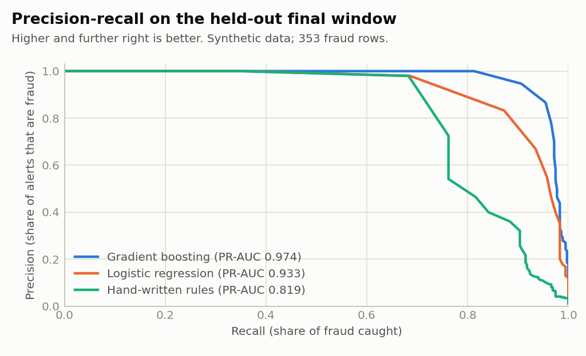
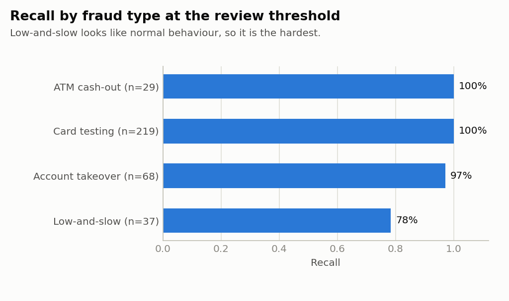

# Real-Time Card Fraud Detection Platform


An end-to-end fraud detection system: a **point-in-time feature store**, an **imbalance-aware model with honest baselines**, a **low-latency scoring API that explains its decisions**, **drift monitoring**, and a **streaming simulator** - with tests and CI.

The focus is the engineering around the model - avoiding train/serve skew, leakage-free evaluation, threshold selection by false-positive budget, idempotent scoring, and monitoring - because that is where most real fraud systems succeed or fail.

> **Data is synthetic.** Real card data is confidential, so `frauddetect.data` simulates it, including hard cases (legitimate travellers, legitimate purchase bursts, fraud that looks normal). Absolute metrics below say how the system behaves on *this simulation*, not how it would perform on a bank's data. Relative comparisons (model vs. baselines, ablations) and the engineering are the point. See [Limitations](#limitations-read-this).

## Results

Time-based split: train on the past, tune thresholds on a validation window, report on the **final, untouched window** (30,644 transactions, 353 fraud rows, ~1.1% fraud).

| Model | PR-AUC | ROC-AUC | Recall @ 0.1% FPR | Recall @ 0.5% FPR | Recall @ 1% FPR |
|---|---|---|---|---|---|
| Hand-written rules | 0.819 | 0.985 | 69.7% | 76.2% | 81.6% |
| Logistic regression | 0.933 | 0.998 | 82.7% | 92.9% | 95.8% |
| **Gradient boosting (deployed)** | **0.974** | **0.999** | **93.2%** | **97.2%** | **97.5%** |



**Operating points** (thresholds chosen on the validation window by FPR budget, then applied to the test window):

| Tier | Policy | Alerts | Precision | Recall | FPR | Fraud value caught |
|---|---|---|---|---|---|---|
| `review` (step-up auth / analyst) | validation FPR <= 0.5% | 486 | 70.6% | 97.2% | 0.47% | 95.9% |
| `decline` | validation FPR <= 0.05% | 337 | 95.0% | 90.7% | 0.056% | 87.7% |

Recall by fraud type at the review threshold: card testing 100% (n=219), ATM cash-out 100% (n=29), account takeover 97% (n=68), **low-and-slow 78% (n=37)** - fraud on the victim's own device that looks like normal behaviour is the hard case.



### Latency

Measured on a 2-vCPU sandbox, single process, 5,000 sequential transactions (in-process) / 2,000 over loopback HTTP:

| Path | p50 | p95 | p99 |
|---|---|---|---|
| In-process `Scorer.score` | 1.6 ms | 3.0 ms | 13.7 ms |
| HTTP round trip (uvicorn, loopback) | 3.4 ms | 13.9 ms | 18.3 ms |

The p99 is driven by **explanations**: approved transactions have a p99 of ~4 ms, while flagged ones take ~14 ms because each runs 8 extra model evaluations to explain itself. That is a deliberate trade-off (explain only what a human will read); see [Design decisions](#design-decisions-and-trade-offs). Throughput is ~470 transactions/s on one core.

### Example decision with reasons

```json
{
  "txn_id": "burst-12", "risk_score": 0.8242, "decision": "decline",
  "reasons": [
    {"factor": "context",  "impact": 8.81, "detail": "digital_goods purchase via ecom"},
    {"factor": "velocity", "impact": 8.61, "detail": "11 transactions in the last 10 min (11 in the last hour, 11 merchants)"},
    {"factor": "amount",   "impact": 1.37, "detail": "amount 2.12 is -0.4 std devs from this account's norm"}
  ],
  "model_version": "hgb-sqrt-112538-s42", "duplicate": false, "latency_ms": 16.8
}
```

## Architecture

```mermaid
flowchart LR
    P[Transaction producer] -->|bounded queue = Kafka topic| C[Consumer / HTTP API]
    C --> F[Feature store<br/>point-in-time, per account]
    F --> M[Gradient boosting model]
    M --> D{Decision}
    D -->|score < review| A[approve]
    D -->|review <= score < block| R[review + reasons]
    D -->|score >= block| X[decline + reasons]
    M --> E[Grouped-occlusion explainer<br/>only for flagged txns]
    F --> W[Drift monitor - PSI]
    M --> W
    W --> H[/metrics]
```

The same `FeatureStore` code computes features for **training** (replaying history in time order) and **serving** (one transaction at a time). There is exactly one implementation of every feature.

## Quick start

```bash
pip install -r requirements-dev.txt
make all          # tests -> generate data -> train -> stream -> benchmark -> drift -> plots
make serve        # then in another terminal: bash scripts/example_requests.sh
```

Individual steps: `make test`, `make train`, `make stream`, `make benchmark`, `make drift`, `make plots`. Or `python -m frauddetect --help` (with `PYTHONPATH=src`).

API:

| Endpoint | Purpose |
|---|---|
| `POST /v1/score` | Score one transaction. Returns risk score, decision, reasons. Validates input (422 on bad payloads). |
| `GET /health` | Liveness + model version. |
| `GET /metrics` | Decision counts, latency percentiles, accounts tracked, live drift (PSI) report. |

Docker: `docker compose up --build` (trains the model at build time).

## Design decisions and trade-offs

**One feature implementation for offline and online.** Train/serve skew is the classic way ML systems fail silently. `FeatureStore.compute()` only *reads* state and `update()` writes it afterwards, so a transaction never sees itself or the future. Tests enforce this: prefix-invariance (features of row *k* don't change if later rows are removed) and exact offline/online parity after a warm-up.

**Time-based splits with a label-delay gap and a burn-in.** Random splits leak the future. The training window ends 2 days before validation starts (fraud labels arrive late via chargebacks), and the first 7 days only build feature-store state (velocity features are meaningless for cold accounts).

**Thresholds come from a false-positive budget, not 0.5.** The business decides how many good customers it will bother; the threshold follows. Two tiers (review at 0.5% FPR, decline at 0.05%) mirror real step-up-auth policies. Scores are risk scores, not calibrated probabilities (class weighting shifts them).

**Imbalance handling was tested, not assumed.** I compared no weighting, sqrt weighting and full balanced weighting on the validation window (validation PR-AUC 0.9625 / 0.9632 / 0.9598): the differences are within noise, so the choice barely matters here. Gradient boosting on well-designed features handles ~1% prevalence without heavy reweighting.

**Honest baselines.** A rules engine and a regularised logistic regression on identical features and the same split. The boosted model earns its complexity (PR-AUC 0.974 vs 0.933 vs 0.819), particularly on the amount-weighted metric: the rules catch only 52% of fraud *value* at the review threshold vs 96% for the model.

**Explain only what a human reads.** Explanations use grouped feature occlusion (replace a feature group with typical values and measure the log-odds drop). Correlated features are grouped (velocity, device, geo...) so reasons read like an analyst wrote them. Cost: 8 extra model calls, so only `review`/`decline` transactions are explained. In production this could move off the critical path.

**Idempotent scoring.** Brokers redeliver messages (at-least-once). A repeated `txn_id` returns the cached decision and does *not* update feature state twice.

**Drift monitoring with PSI.** A rolling window of live features and scores is compared with the training distribution. On a same-distribution window max PSI is 0.03 (stable); on a population with amounts scaled 1.6x and 25% more e-commerce it is 0.20 (watch), flagging `amount` and `channel_code`. Rule of thumb: <0.10 stable, 0.10-0.25 watch, >0.25 investigate.

## How the project got here (bugs found and fixed)

Kept in the README on purpose - these are the kinds of problems that matter.

1. **Silent train/serve skew.** A parity check showed the streaming replay flagging 647 alerts vs 456 offline. Cause: `store or FeatureStore()` - an *empty* store has length 0, is falsy, and was silently replaced, discarding the warm-up. Fixed, with a regression test.
2. **Fake drift.** The drift demo flagged a same-distribution window because an "account age" feature grows with the calendar in a simulation that starts cold. The feature was removed rather than the alarm being silenced.
3. **Shortcut in the simulator.** Every attacker used one of only 40 devices, so the model learned "device seen on other accounts" and ignored velocity; a brand-new card-testing burst sailed through. Half of attacks now use fresh devices, which made the problem harder and the model actually learn velocity.

## Limitations (read this)

- **Synthetic data.** Metrics are optimistic relative to real portfolios: the simulator's fraud types are cleaner than reality and the feature set is designed against them.
- **Small test set.** 353 fraud rows from roughly 70 fraud incidents; rows within an incident are correlated, so confidence intervals are wide. Don't over-read differences in the third decimal.
- **Simplifications:** shared UTC clock (no per-account time zones); no account-age, merchant-risk or network features; explanations ignore cross-group interactions (they are not Shapley values).
- **State is in process memory.** The API must run as a single worker. See below.
- **Latency numbers** are from a small shared sandbox; treat them as order-of-magnitude.
- `joblib` artifacts are pickles: only load models you trained yourself.
- The GitHub Actions workflow runs green on Python 3.10-3.12. The Dockerfile has not been tested end to end.

## Scaling out (what changes in production)

| Here | Production equivalent |
|---|---|
| Bounded `queue.Queue` | Kafka topic partitioned by `account_id` (per-account ordering); the consumer loop in `stream.py` is what the Kafka consumer would call |
| In-memory `FeatureStore` | Redis hashes / a feature store (Feast, Tecton); makes API workers stateless |
| `HistGradientBoostingClassifier` | XGBoost / LightGBM - the model sits behind `decision_function`, so the swap is small |
| Grouped occlusion | SHAP `TreeExplainer` for exact attributions |
| Rolling-window PSI on `/metrics` | Prometheus/Grafana with alerting, plus delayed-label performance monitoring |
| Train at build time | Scheduled retraining, model registry, shadow/canary deployment |

## Project layout

```
src/frauddetect/
  data.py       synthetic transactions + fraud typologies
  features.py   point-in-time feature store (single source of truth)
  model.py      splits, weighting search, baselines, metrics, thresholds
  explain.py    grouped-occlusion explanations
  drift.py      PSI drift monitor
  scoring.py    thread-safe, idempotent online scorer
  service.py    Starlette API + pydantic validation
  stream.py     queue-based streaming simulator
  benchmark.py  in-process and HTTP latency
  plots.py      README charts
tests/          46 tests (features/leakage/parity, splits, metrics, scorer, API, drift)
results/        train_report.json, benchmark.json, drift_demo.json, ...
```
